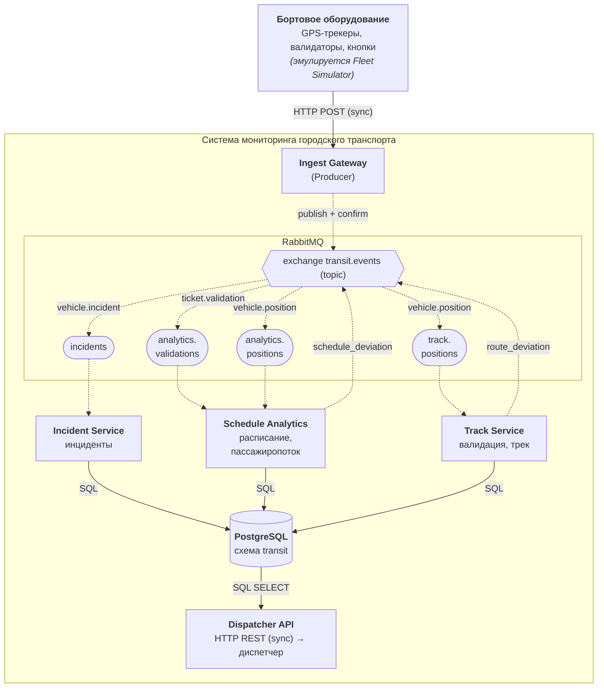

# Transit Monitor – распределенная система мониторинга городского транспорта

Учебный проект по дисциплине «Технологии распределенной обработки цифровых данных» (БГУИР, 2026).

Система принимает события бортового оборудования автобусов, троллейбусов и трамваев – координаты GPS-трекеров (`vehicle.position`), проходы через валидаторы (`ticket.validation`) и инциденты (`vehicle.incident`), – передает их через брокер RabbitMQ независимым обработчикам и сохраняет в PostgreSQL трек и состояние парка, отклонения от расписания, пассажиропоток и инциденты для диспетчерской службы. Расчетная нагрузка: 1 200 машин на линии, до 151 сообщения в секунду, 7,1 млн сообщений и 2,5 ГБ в сутки.

## Архитектура

Сплошная линия – синхронное взаимодействие (HTTP, SQL), пунктир – асинхронное (AMQP).



| Компонент | Роль | Каталог |
|---|---|---|
| Fleet Simulator | Источник данных: эмулятор бортового оборудования парка | `simulator/` |
| Ingest Gateway | Producer: прием HTTP, присвоение `message_id`, публикация | `producer/` |
| RabbitMQ | Брокер: exchange `transit.events` (topic), 4 очереди | – |
| Track Service | Обработчик: валидация координат, трек, сход с маршрута | `services/track-service/` |
| Schedule Analytics Service | Обработчик: прибытия, опоздания, пассажиропоток | `services/analytics-service/` |
| Incident Service | Обработчик: регистрация и приоритизация инцидентов | `services/incident-service/` |
| PostgreSQL | Хранилище, схема `transit` | `database/` |
| Dispatcher API | REST API для диспетчера | `services/dispatcher-api/` |

## Документация

1. [Предметная область](docs/01-domain.md)
2. [Данные и формат сообщений](docs/02-data.md) – [JSON Schema](docs/schemas/message.schema.json), [примеры](docs/examples)
3. [Компоненты](docs/03-components.md)
4. [Потоки данных, sync/async, диаграмма последовательности](docs/04-flows.md)
5. [Технологический стек](docs/05-stack.md)
6. [Анализ архитектуры: узкие места, SPOF, отказоустойчивость](docs/06-analysis.md)

Диаграммы: [architecture.mmd](docs/diagrams/architecture.mmd), [sequence.mmd](docs/diagrams/sequence.mmd) (PNG рядом).

## Стек

Python 3.12 (FastAPI, aio-pika, asyncpg) · RabbitMQ 4.1 · PostgreSQL 17 · Docker Compose · Kubernetes (Minikube) · Mermaid.

## Проверки

```bash
pip install jsonschema
python tools/validate_examples.py   # примеры сообщений соответствуют схеме, message_id = UUID v5
python tools/capacity.py            # оценка интенсивности и объема потоков
psql -d <пустая БД> -f database/init/001_schema.sql -f database/tests/smoke_test.sql
```

## План лабораторных работ

| ЛР | Тема | Результат в репозитории |
|---|---|---|
| 1 | Проектирование архитектуры | `docs/`, схема БД, форматы сообщений |
| 2 | Producer–Consumer | Gateway, Fleet Simulator, обработчики, маршрутизация по типам, эксперименты с 1/2/4 Consumers |
| 3 | Retry, DLQ, идемпотентность | `transit.retry`, `transit.dlx`, очереди `*.retry` и `*.dlq`, `processed_messages` |
| 4 | Контейнеризация | Dockerfile компонентов, `docker-compose.yml`, тома RabbitMQ и PostgreSQL |
| 5 | Kubernetes | Манифесты Deployment/Service/ConfigMap/Secret, масштабирование Track Service 1 → 2 → 4 |
| 6 | Тестирование и оптимизация | Генератор нагрузки, chaos-сценарии, метрики throughput/latency, аудит узких мест |
