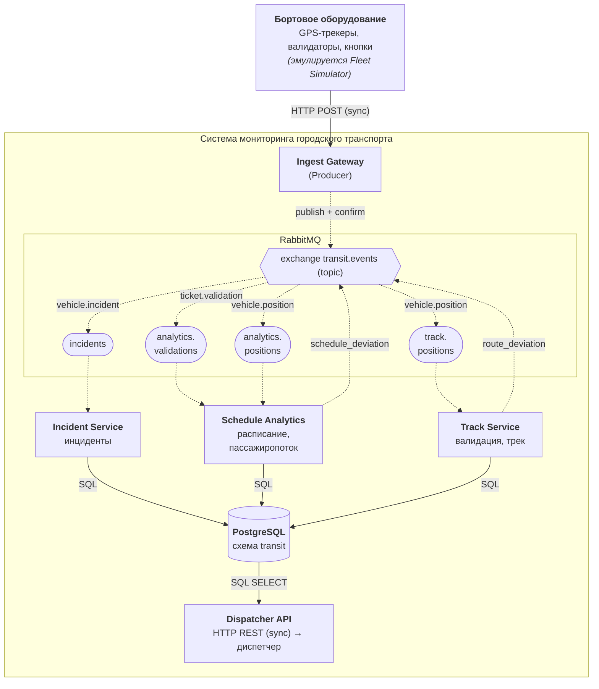
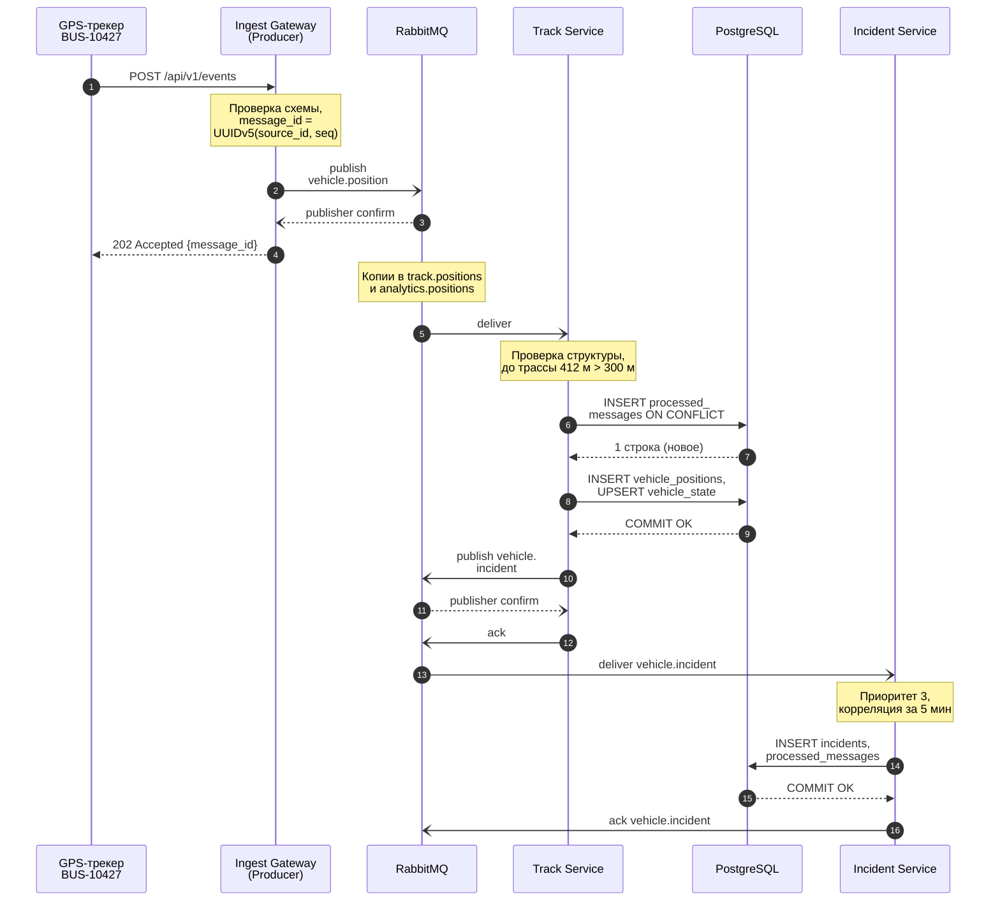

# 4. Потоки данных и типы взаимодействия

## Архитектурная диаграмма

Сплошная линия – синхронное взаимодействие (HTTP, SQL), пунктир – асинхронное (AMQP). Подпись стрелки от exchange к очереди – routing key.

## Потоки данных

| Поток | Путь | Данные |
|---|---|---|
| П1 | Трекер → Gateway → `transit.events` → `track.positions` → Track Service → PostgreSQL | `vehicle.position` → `vehicle_positions`, `vehicle_state` |
| П2 | `transit.events` → `analytics.positions` → Schedule Analytics → PostgreSQL | `vehicle.position` → `stop_arrivals` |
| П3 | Валидатор → Gateway → `transit.events` → `analytics.validations` → Schedule Analytics → PostgreSQL | `ticket.validation` → `passenger_flow` |
| П4 | Кнопка / диагностика → Gateway → `transit.events` → `incidents` → Incident Service → PostgreSQL | `vehicle.incident` → `incidents` |
| П5 | Track Service, Schedule Analytics → `transit.events` → `incidents` → Incident Service → PostgreSQL | производные `vehicle.incident` → `incidents` |
| П6 | PostgreSQL → Dispatcher API → диспетчер | состояние парка, опоздания, инциденты |

## Синхронные и асинхронные взаимодействия

| № | Взаимодействие | Тип | Обоснование |
|---|---|---|---|
| 1 | Fleet Simulator → Ingest Gateway | sync (HTTP) | Устройству нужно подтверждение приема: пока не получен 202, событие остается в буфере устройства и будет отправлено повторно |
| 2 | Ingest Gateway → RabbitMQ | async (AMQP, publisher confirms) | Шлюз не ждет обработки – только подтверждения записи в брокер; брокер буферизует пики (утренний час пик, массовая отправка после восстановления связи) |
| 3 | RabbitMQ → Track Service | async (AMQP) | Трек записывается в своем темпе; при остановке сервиса координаты накапливаются в очереди и не теряются |
| 4 | RabbitMQ → Schedule Analytics | async (AMQP) | Аналитика тяжелее записи трека и может отставать, не замедляя остальной поток; масштабируется отдельно |
| 5 | RabbitMQ → Incident Service | async (AMQP) | Отдельная очередь: инциденты не стоят за тысячами координат, обработка не зависит от загрузки трековых сервисов |
| 6 | Track Service → RabbitMQ (`route_deviation`) | async (AMQP) | Track Service не знает о потребителях инцидентов; новый потребитель (например, SMS-оповещение) подключается без изменения сервиса |
| 7 | Schedule Analytics → RabbitMQ (`schedule_deviation`) | async (AMQP) | То же: публикация события вместо прямого вызова снижает связанность |
| 8 | Track Service → PostgreSQL | sync (SQL) | Ack брокеру отправляется только после фиксации транзакции – иначе при сбое сообщение было бы потеряно |
| 9 | Schedule Analytics → PostgreSQL | sync (SQL) | То же; кроме того, справочники расписания нужны до начала обработки |
| 10 | Incident Service → PostgreSQL | sync (SQL) | Инцидент должен быть гарантированно записан до подтверждения |
| 11 | Dispatcher API → PostgreSQL | sync (SQL) | Запрос диспетчера требует немедленного ответа |
| 12 | Диспетчер → Dispatcher API | sync (HTTP) | Интерактивная работа: пользователь ждет данные на экране |

Итог: 12 взаимодействий, 6 синхронных и 6 асинхронных. Все связи между компонентами обработки асинхронные (через брокер), синхронные – только на границах системы (прием от устройств, выдача диспетчеру) и при работе с БД.

## Диаграмма последовательности

Сценарий: отметка `vehicle.position` машины BUS-10427, отклонившейся от трассы на 412 м, – от трекера до регистрации инцидента. `->>` – синхронный вызов, `-)` – асинхронная отправка, `-->>` / `--)` – ответ и подтверждение.

