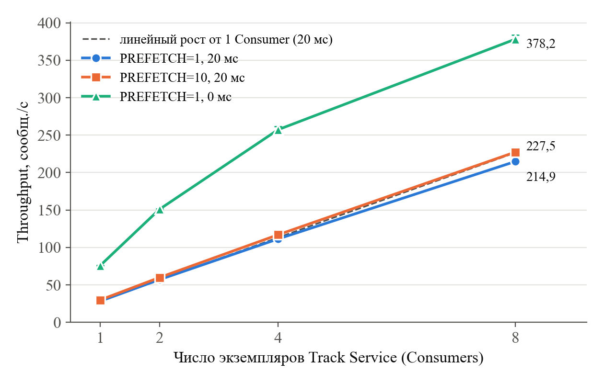
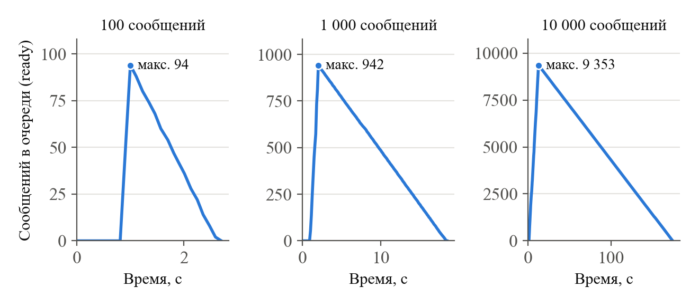

# Результаты экспериментов ЛР 2

Сформировано `python tools/report_experiments.py` из `docs/lab2/results/*.json`.

Условия: один компьютер (12 логических ядер, Windows 11), RabbitMQ 4.1 и PostgreSQL 17 в Docker Desktop, Python 3.12; каждый прогон с чистого состояния (TRUNCATE, purge), 3 повтора, в таблицах – среднее и разброс. Throughput = обработано / (max(processed_at) − min(produced_at)); produced_at – момент публикации шлюзом, processed_at – момент фиксации результата потребителем (часы одного компьютера). Эксперименты 2 и 3 – только vehicle.position, 1200 машин, Track Service.

## Эксперимент 1: 100 событий всех типов

| Прогон | Отправлено (pos / val / inc) | Track: получено / обработано | Analytics: получено / обработано | Incident: получено / обработано | Потери |
|---|---|---|---|---|---|
| 1 | 100 (79 / 15 / 6) | 79 / 79 | 94 / 94 | 6 / 6 | 0 |
| 2 | 100 (83 / 11 / 6) | 83 / 83 | 94 / 94 | 6 / 6 | 0 |
| 3 | 100 (89 / 7 / 4) | 89 / 89 | 96 / 96 | 4 / 4 | 0 |

## Эксперимент 2: PREFETCH=1, 20 мс

| Consumers | Обработано | Время, с | Throughput, msg/с (min–max) | Ускорение | Распределение | Задержка ср. / p95, с |
|---|---|---|---|---|---|---|
| 1 | 1000 | 35,25 | 28,3 (28,2–28,4) | 1,00× | c1=1000 | 17,24 / 32,60 |
| 2 | 1000 | 17,50 | 57,1 (57,1–57,2) | 2,02× | c1=500, c2=500 | 8,37 / 15,71 |
| 4 | 1000 | 8,97 | 111,5 (110,2–112,2) | 3,93× | c1=250, c2=250, c3=250, c4=250 | 4,06 / 7,38 |
| 8 | 1000 | 4,65 | 214,9 (213,6–217,3) | 7,58× | c1=125, c2=126, c3=125, c4=125, c5=126, c6=125, c7=124, c8=124 | 1,88 / 3,24 |

## Эксперимент 2: PREFETCH=10, 20 мс

| Consumers | Обработано | Время, с | Throughput, msg/с (min–max) | Ускорение | Распределение | Задержка ср. / p95, с |
|---|---|---|---|---|---|---|
| 1 | 1000 | 33,35 | 30,0 (29,8–30,1) | 1,00× | c1=1000 | 16,29 / 30,70 |
| 2 | 1000 | 16,67 | 60,0 (59,7–60,1) | 2,00× | c1=500, c2=500 | 7,94 / 14,87 |
| 4 | 1000 | 8,54 | 117,1 (116,4–117,4) | 3,91× | c1=251, c2=250, c3=250, c4=249 | 3,84 / 7,03 |
| 8 | 1000 | 4,40 | 227,5 (225,3–230,3) | 7,59× | c1=125, c2=125, c3=125, c4=125, c5=125, c6=125, c7=125, c8=125 | 1,75 / 2,99 |

## Эксперимент 2: PREFETCH=1, 0 мс

| Consumers | Обработано | Время, с | Throughput, msg/с (min–max) | Ускорение | Распределение | Задержка ср. / p95, с |
|---|---|---|---|---|---|---|
| 1 | 2000 | 26,36 | 75,9 (75,6–76,2) | 1,00× | c1=2000 | 12,36 / 23,05 |
| 2 | 2000 | 13,24 | 151,0 (149,9–151,9) | 1,99× | c1=1001, c2=999 | 5,73 / 10,16 |
| 4 | 2000 | 7,77 | 257,3 (252,3–261,5) | 3,39× | c1=500, c2=500, c3=500, c4=500 | 2,56 / 4,29 |
| 8 | 2000 | 5,29 | 378,2 (373,0–383,5) | 4,98× | c1=250, c2=251, c3=251, c4=250, c5=250, c6=249, c7=250, c8=249 | 0,65 / 0,89 |

## Эксперимент 3: 2 Consumers, PREFETCH=1, 20 мс

| Сообщений | Время, с | Throughput, msg/с (min–max) | Потери | Максимальный размер очереди | Отправка шлюзом, с |
|---|---|---|---|---|---|
| 100 | 1,77 | 56,3 (56,2–56,4) | 0 | 93 (92–94) | 0,06 |
| 1000 | 17,53 | 57,0 (56,7–57,2) | 0 | 935 (930–942) | 1,09 |
| 10000 | 173,65 | 57,6 (57,6–57,6) | 0 | 9 355 (9343–9368) | 11,42 |

## Время на одно сообщение (1 Consumer, медианы по журналу)

| Вариант | Обработка (received → processed), мс | Ожидание следующей доставки, мс |
|---|---|---|
| PREFETCH=1, 20 мс | 32,0 | 2,0 |
| PREFETCH=10, 20 мс | 32,0 | 1,0 |
| PREFETCH=1, 0 мс | 10,0 | 2,0 |
