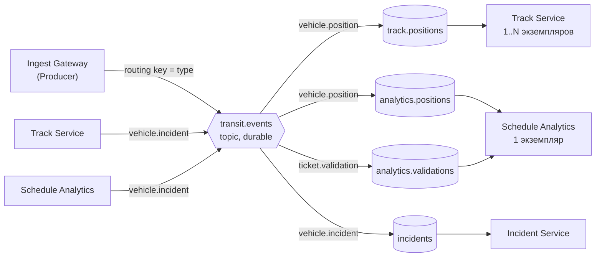

# Топология брокера (ЛР 2)

Брокер – RabbitMQ 4.1 (образ `rabbitmq:4.1-management`), виртуальный хост `/`. Полное описание объектов в формате
`rabbitmqctl export_definitions` – [`broker/definitions.json`](../../broker/definitions.json).



| Exchange | Тип | Routing key | Очередь | Кто читает |
|---|---|---|---|---|
| `transit.events` | topic | `vehicle.position` | `track.positions` | Track Service (конкурирующие экземпляры) |
| `transit.events` | topic | `vehicle.position` | `analytics.positions` | Schedule Analytics Service |
| `transit.events` | topic | `ticket.validation` | `analytics.validations` | Schedule Analytics Service |
| `transit.events` | topic | `vehicle.incident` | `incidents` | Incident Service |

Свойства:

- exchange и все очереди `durable` (переживают перезапуск брокера), классические очереди;
- сообщения публикуются с `delivery_mode=2` (persistent), `content_type=application/json`, `message_id` и `type`
  в AMQP-свойствах; `mandatory=True` – неразмещенное сообщение возвращается издателю как ошибка;
- publisher confirms на каналах шлюза и сервисов, публикующих инциденты: шлюз отвечает 202 только после `basic.ack`
  брокера;
- потребители – ручное подтверждение (`no_ack=False`), `basic.qos(prefetch_count=PREFETCH)`; ack после фиксации
  транзакции в PostgreSQL; сообщение с ошибкой структуры – `basic.reject(requeue=False)` (в ЛР 3 – в DLQ);
  ошибка БД – `basic.nack(requeue=True)`;
- топологию идемпотентно объявляет каждый компонент: шлюз – все четыре очереди (чтобы сообщения ждали запуска
  потребителей), сервисы – свои очереди и очередь `incidents`, в которую они публикуют.

Почему `topic`, а не `direct`: сейчас ключи совпадают с типами точно, но шаблоны позволят без изменения издателей
подписать, например, журнал всех событий машины на `vehicle.#` или новую очередь на `*.incident`.

Проверка в работающем брокере:

```bash
docker exec transit-rabbitmq rabbitmqctl list_exchanges name type durable | grep transit
docker exec transit-rabbitmq rabbitmqctl list_bindings source_name destination_name routing_key | grep transit
docker exec transit-rabbitmq rabbitmqctl list_queues name durable messages_ready messages_unacknowledged consumers
```
