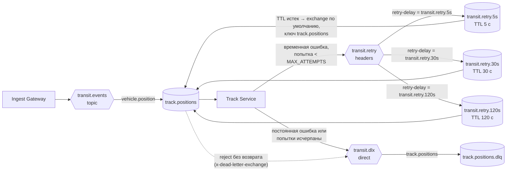

# Обработка ошибок, Retry, DLQ и идемпотентность (ЛР 3)

Общая обвязка потребителей – [`common/reliability.py`](../../common/reliability.py); ее используют Track Service,
Schedule Analytics Service и Incident Service, а функцию `declare_topology` – еще и Ingest Gateway, поэтому
аргументы очередей у всех компонентов совпадают.

## Топология брокера



На схеме показана одна рабочая очередь; остальные (`analytics.positions`, `analytics.validations`, `incidents`)
устроены так же и делят с ней очереди ожидания.

| Объект | Тип / аргументы | Назначение |
|---|---|---|
| `transit.events` | topic | Рабочие сообщения (без изменений с ЛР 2) |
| `track.positions` и др. | `x-dead-letter-exchange = transit.dlx`, `x-dead-letter-routing-key = <имя очереди>` | Рабочие очереди; аргументы DLX – страховка на случай `basic.reject(requeue=false)` |
| `transit.retry` | headers | Прием копий на повтор; маршрут – по заголовку `retry-delay` (заголовки `x-*` headers exchange при сопоставлении игнорирует) |
| `transit.retry.<задержка>` | `x-message-ttl = задержка`, `x-dead-letter-exchange = ""` | Очередь ожидания без потребителей: по истечении TTL сообщение уходит в exchange по умолчанию с исходным routing key, равным имени рабочей очереди, т. е. возвращается в свою очередь |
| `transit.dlx` | direct | Прием сообщений, которые не удалось обработать |
| `<очередь>.dlq` | durable | Dead Letter Queue: хранение для анализа и повторной отправки ([`tools/dlq.py`](../../tools/dlq.py)) |

Очередь ожидания своя для каждого значения задержки, а не для каждой рабочей очереди: в классической очереди
сообщения истекают только из головы, и копия с задержкой 120 с задержала бы стоящую за ней копию с задержкой 5 с.

## Обработка доставки

1. Номер попытки – заголовок `x-attempt` (у сообщения от шлюза его нет – попытка 1).
2. Разбор JSON и проверка по JSON Schema. Ошибка – **постоянная** (`ValueError`): сразу в DLQ.
3. Бизнес-обработка в одной транзакции PostgreSQL:
   - первая операция – `claim`: `INSERT INTO processed_messages (consumer, message_id, …) ON CONFLICT DO NOTHING`;
     0 вставленных строк – сообщение уже обработано: операция не выполняется, итог `duplicate`;
     параллельная обработка той же копии другим экземпляром ждет на уникальном ключе до фиксации первой;
   - бизнес-операции (трек, состояние, прибытие, пассажиропоток, инцидент);
   - точка имитации сбоя (`FAULT_RATE`, `FAULT_POISON`) и запись итога в `processed_messages`;
   - COMMIT. При любой ошибке – ROLLBACK: частичных результатов нет.
4. Ошибка классифицируется: `ValueError`, `KeyError`, `TypeError`, `asyncpg.DataError`, нарушение ограничений –
   постоянные; остальное (обрыв соединения с БД, тайм-аут `DB_TIMEOUT_S`, ошибка AMQP, имитированный сбой) –
   **временные**. Временная ошибка при `attempt < MAX_ATTEMPTS` – копия с `x-attempt + 1` публикуется в
   `transit.retry`; иначе – в `transit.dlx` с заголовками `x-last-error`, `x-error-class`, `x-attempt`,
   `x-failed-by`, `x-failed-at`, `x-original-queue`.
5. Ack исходной доставки – только после COMMIT или подтвержденной брокером (publisher confirms) пересылки
   в retry/DLQ. Если переслать не удалось – `nack(requeue=true)`: сообщение не теряется.
6. Каждая попытка записывается в `processing_log` (идентификатор, время получения и окончания, номер попытки,
   признак redelivered, итог, причина ошибки) и в журнал процесса. Если БД недоступна, остается журнал процесса.

Производные события (инцидент `route_deviation` от Track Service, `schedule_deviation` от Schedule Analytics)
публикуются после COMMIT. Если публикация не удалась, сообщение повторяется, `claim` находит его как дубликат
с итогом `stored_route_deviation` / `arrival_late:…` и публикует событие снова; его `message_id` детерминирован,
поэтому Incident Service отбросит возможный дубликат.

## Параметры (переменные окружения, без изменения кода)

| Переменная | По умолчанию | Назначение |
|---|---|---|
| `MAX_ATTEMPTS` | 4 | Всего попыток, включая первую |
| `RETRY_DELAYS_MS` | 5000,30000,120000 | Задержки перед 2-й, 3-й, 4-й попыткой; последняя повторяется, если попыток больше |
| `DB_TIMEOUT_S` | 10 | Тайм-аут подключения и запроса к PostgreSQL: зависание БД становится временной ошибкой |
| `FAULT_RATE` | 0 | Вероятность имитированного временного сбоя на каждой попытке |
| `FAULT_POISON` | – | `source_id` или `message_id` через запятую: такие сообщения не обрабатываются никогда |
| `FAULT_ACK_LOSS_RATE` | 0 | Вероятность «потери» ack после COMMIT: сообщение возвращается брокером повторно |
| `FAULT_SEED` | 0 | Зерно: решение о сбое – хеш (зерно, `message_id`, попытка), прогоны воспроизводимы |

## Хранилище

[`database/init/003_reliability.sql`](../../database/init/003_reliability.sql): столбец `attempt` в
`processed_messages` и таблица `processing_log`. Скрипт применяется и к новой, и к уже развернутой БД.

```sql
-- история обработки сообщения
SELECT consumer, instance_id, attempt, outcome, error, received_at
FROM transit.processing_log WHERE message_id = '…' ORDER BY id;
-- сводка по итогам
SELECT consumer, outcome, count(*) FROM transit.processing_log GROUP BY 1, 2 ORDER BY 1, 2;
```

## Работа с DLQ

```bash
python tools/dlq.py stats                        # число сообщений во всех DLQ
python tools/dlq.py show track.positions.dlq     # причины, число попыток, экземпляр (сообщения остаются в DLQ)
python tools/dlq.py replay track.positions.dlq   # вернуть в рабочую очередь с x-attempt = 1 после устранения причины
```

## Эксперименты

`./run_lab3.sh` (около 5 мин), затем `python tools/report_lab3.py` – таблицы [`experiments.md`](experiments.md) и
графики. Сырые результаты – `results/*.json`, журналы всех компонентов – `logs/<эксперимент>/`, ручные проверки
(DLQ, replay) – `logs/checks/`.
