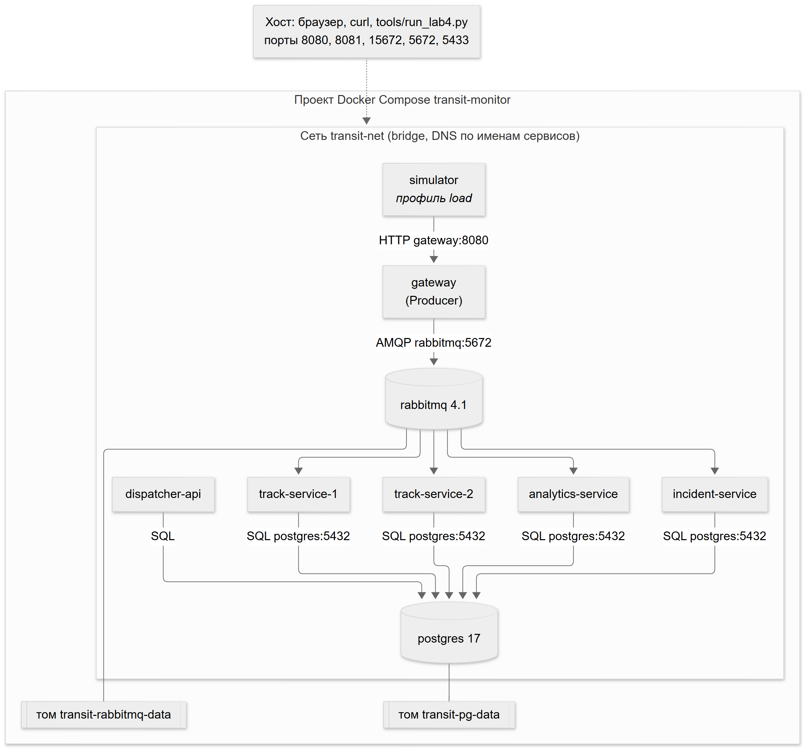

# Контейнеризация (ЛР 4)

## Образы

| Компонент | Dockerfile | Содержимое образа | Команда | Healthcheck |
|---|---|---|---|---|
| Ingest Gateway | `producer/Dockerfile` | `src/gateway.py`, `common/`, `docs/schemas/` | `python src/gateway.py` | `GET /health` |
| Track Service | `services/track-service/Dockerfile` | `src/track_service.py`, `common/`, `docs/schemas/` | `python src/track_service.py` | – |
| Schedule Analytics | `services/analytics-service/Dockerfile` | `src/analytics_service.py`, `common/`, `docs/schemas/` | `python src/analytics_service.py` | – |
| Incident Service | `services/incident-service/Dockerfile` | `src/incident_service.py`, `common/`, `docs/schemas/` | `python src/incident_service.py` | – |
| Dispatcher API | `services/dispatcher-api/Dockerfile` | `src/dispatcher_api.py` | `python src/dispatcher_api.py` | `GET /health` (запрос к БД) |
| Fleet Simulator | `simulator/Dockerfile` | `src/fleet_simulator.py`, `src/routes.json` | `ENTRYPOINT python src/fleet_simulator.py` | – |

Общее: база `python:3.12-slim`; слой зависимостей (`requirements.txt` компонента) копируется и устанавливается до
исходного текста – при изменении кода пересобирается только последний слой; процесс работает от системного
пользователя `app`; контекст сборки – корень репозитория, `.dockerignore` исключает `.venv`, журналы и результаты
экспериментов. Модуль `common/` и JSON Schema находятся по поиску каталога `common` вверх от файла сервиса, поэтому
один и тот же код работает и в репозитории, и в образе (`/app`).

## Сервисы compose

`docker-compose.yml` описывает 9 сервисов проекта `transit-monitor`: `rabbitmq`, `postgres`, `gateway`,
`track-service-1`, `track-service-2`, `analytics-service`, `incident-service`, `dispatcher-api` и `simulator`
(профиль `load` – запускается по требованию). Порядок запуска задают `depends_on` с `condition: service_healthy`:
потребители стартуют после готовности брокера и БД, шлюз – после брокера, эмулятор – после шлюза.
`restart: unless-stopped` поднимает упавший процесс, но не контейнер, остановленный вручную (`docker compose stop`).

## Сеть

Все сервисы подключены к пользовательской сети `transit-net` (bridge). Встроенный DNS Docker разрешает имена
сервисов: шлюз подключается к `rabbitmq:5672`, потребители – к `rabbitmq:5672` и `postgres:5432`, эмулятор – к
`gateway:8080`. На хост опубликованы только порты для пользователя и стендов: 8080 (шлюз), 8081 (API), 15672
(веб-консоль RabbitMQ), 5672 и 5433 (брокер и БД для `tools/`).

## Конфигурация

Параметры – переменные окружения; значения берутся из `.env` (образец – `.env.example`) и подставляются в
`docker-compose.yml`: учетные данные и порты брокера и БД, из которых собираются `RABBIT_URL` и `DB_DSN`,
`PREFETCH`, `PROCESS_DELAY_MS`, `DB_TIMEOUT_S`, `MAX_ATTEMPTS`, `RETRY_DELAYS_MS`, `FAULT_RATE`, `HEADWAY_MIN`.
`CONSUMER_ID` задан у каждого экземпляра (`track-1`, `track-2`, `analytics-1`, `incident-1`). Пользователь `guest`
RabbitMQ подключается только с localhost, поэтому брокер создает пользователя из `RABBITMQ_USER`.

## Постоянное хранение

| Том | Точка монтирования | Что хранится |
|---|---|---|
| `transit-pg-data` | `/var/lib/postgresql/data` | данные PostgreSQL: справочники, трек, состояние парка, инциденты, журналы обработки |
| `transit-rabbitmq-data` | `/var/lib/rabbitmq` | durable-очереди и persistent-сообщения брокера, в том числе ожидающие обработки |

`docker compose down` удаляет контейнеры и сеть, тома остаются; `docker compose down -v` удаляет и тома. У сервиса
`rabbitmq` задан `hostname: rabbitmq`: имя узла `rabbit@rabbitmq` определяет каталог базы сообщений в томе, и без
постоянного имени новый контейнер не увидел бы данные прежнего. Схема БД (`database/init/001–003`) монтируется в
`/docker-entrypoint-initdb.d` и выполняется только при пустом томе.

## Поведение при отказах

| Отказ | Что происходит | Восстановление |
|---|---|---|
| Остановка одного из экземпляров Track Service | неподтвержденные доставки возвращаются в очередь, их и весь поток получает второй экземпляр | после `start` брокер снова делит поток поровну |
| Остановка Analytics Service (единственный экземпляр) | шлюз продолжает публикацию, сообщения копятся в `analytics.*` | после `start` накопленное обрабатывается, дубликаты отсекает `processed_messages` |
| Перезапуск PostgreSQL | транзакции завершаются ошибкой соединения → Retry через `transit.retry` (ЛР 3); API отвечает 503; шлюз и брокер не затронуты | пул asyncpg переподключается, повторные попытки завершаются успешно |
| `docker compose down` / `up` | все контейнеры удалены | очереди с накопленными сообщениями и данные БД восстанавливаются из томов |

Результаты экспериментов – [`experiments.md`](experiments.md), стенд – `tools/run_lab4.py`.
