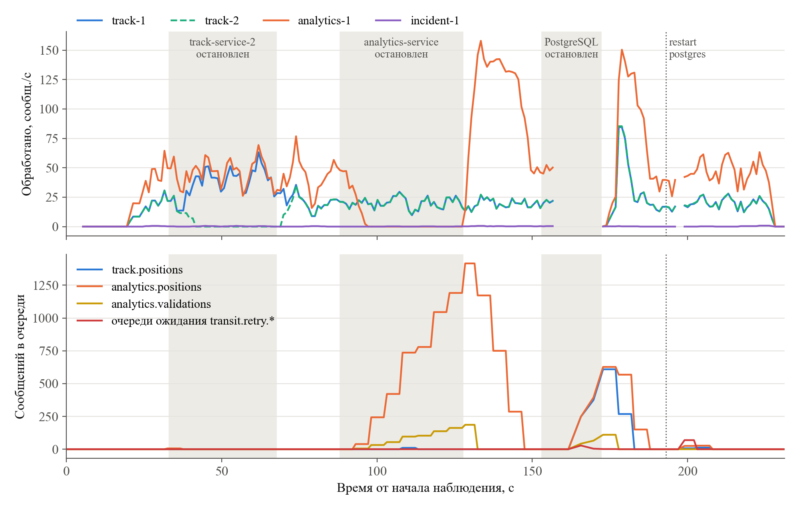

# Эксперименты ЛР 4: система в Docker Compose

## Запуск

`docker compose up -d`: все 8 постоянных контейнеров готовы (healthcheck) за 24,9 с; сборка образов (кэш) – 3,4 с.

| Сервис | Отправлено | Ожидалось | Обработано | Потеряно |
|---|---|---|---|---|
| track-service | – | 881 | 881 | 0 |
| analytics-service | – | 1000 | 1000 | 0 |
| incident-service | – | 7 | 7 | 0 |

Эмулятор: 1000 событий {'vehicle.position': 881, 'ticket.validation': 119, 'vehicle.incident': 0}; экземпляры: {'analytics-1': 1000, 'incident-1': 7, 'track-2': 441, 'track-1': 440}; DLQ: {'analytics.positions.dlq': 0, 'analytics.validations.dlq': 0, 'incidents.dlq': 0, 'track.positions.dlq': 0}

## Отказы под нагрузкой

Нагрузка: 9355 событий за 210,8 с (44,4 событий/с) {'vehicle.position': 8157, 'ticket.validation': 1183, 'vehicle.incident': 15}.

| Этап | До отказа | Во время отказа | После восстановления |
|---|---|---|---|
| Остановка track-service-2 | track-1 20,0, track-2 19,9 сообщ./с; очередь ≤ 0 | track-1 43,6, track-2 0 сообщ./с; очередь ≤ 0 | track-1 20,6, track-2 19,7 сообщ./с |
| Остановка analytics-service | 44,4 сообщ./с; очереди ≤ 0 | 0 сообщ./с; очереди до 1602 | разбор за 20,0 с, пик 164,9 сообщ./с |
| Остановка PostgreSQL на 19,0 с | 77,8 сообщ./с, API [200] | API ['200', 'None'], очереди ≤ 837, в ожидании retry ≤ 69 | API 200 через 0,8 с, очереди пусты через 15,9 с, retry – 5,8 с |
| restart postgres (4,7 с) | – | API ['200', 'None'] | – |

| Сервис | Ожидалось | Обработано | Потеряно |
|---|---|---|---|
| track-service | 8157 | 8157 | 0 |
| analytics-service | 9340 | 9340 | 0 |
| incident-service | 39 | 39 | 0 |

Экземпляры: {'analytics-1': 9340, 'incident-1': 39, 'track-2': 3445, 'track-1': 4712}; DLQ: {'analytics.positions.dlq': 0, 'analytics.validations.dlq': 0, 'incidents.dlq': 0, 'track.positions.dlq': 0}; исходы попыток: {'duplicate': 3, 'success': 17533, 'retry': 2}

| Сервис | Retry | DLQ | Повторно доставлено | Дубликаты | Ошибки |
|---|---|---|---|---|---|
| track-service-1 | 21 | 0 | 6 | 1 | {'CannotConnectNowError': 6, 'ConnectionRefusedError': 13, 'InterfaceError': 1, 'gaierror': 1} |
| track-service-2 | 21 | 0 | 0 | 0 | {'CannotConnectNowError': 7, 'ConnectionDoesNotExistError': 1, 'ConnectionRefusedError': 11, 'InternalClientError': 1, 'gaierror': 1} |
| analytics-service | 59 | 0 | 44 | 2 | {'CannotConnectNowError': 12, 'ConnectionDoesNotExistError': 1, 'ConnectionRefusedError': 40, 'ConnectionResetError': 2, 'InterfaceError': 1, 'InternalClientError': 1, 'gaierror': 2} |
| incident-service | 1 | 0 | 0 | 0 | {'gaierror': 1} |

## Сохранность данных

Обработчики остановлены, отправлено 1000 событий; очереди перед down: {'analytics.positions': 845, 'analytics.validations': 154, 'incidents': 0, 'track.positions': 845}; после up: {'analytics.positions': 579, 'analytics.validations': 0, 'incidents': 0, 'track.positions': 221}.

down – 8,4 с, контейнеров после down: 0, тома: ['transit-pg-data', 'transit-rabbitmq-data']; up до готовности – 8,3 с, разбор – 6,3 с.

| Таблица | Строк до down | Строк после up и разбора очередей | Прирост |
|---|---|---|---|
| passenger_flow | 20 | 20 | 0 |
| stop_arrivals | 122 | 154 | 32 |
| incidents | 46 | 52 | 6 |
| vehicle_state | 881 | 881 | 0 |
| processing_log | 19426 | 21276 | 1850 |
| processed_messages | 19424 | 21274 | 1850 |
| vehicle_positions | 9038 | 9883 | 845 |

Записи vehicle_positions, существовавшие до down: 9038 строк, md5 e9a04730 (совпадает со снимком до down).
