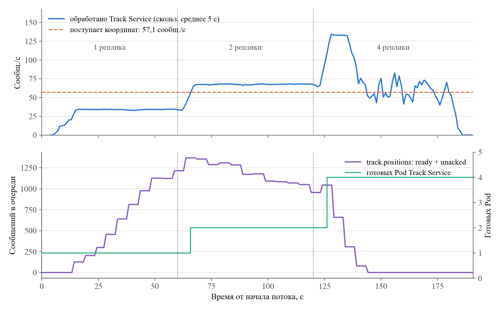
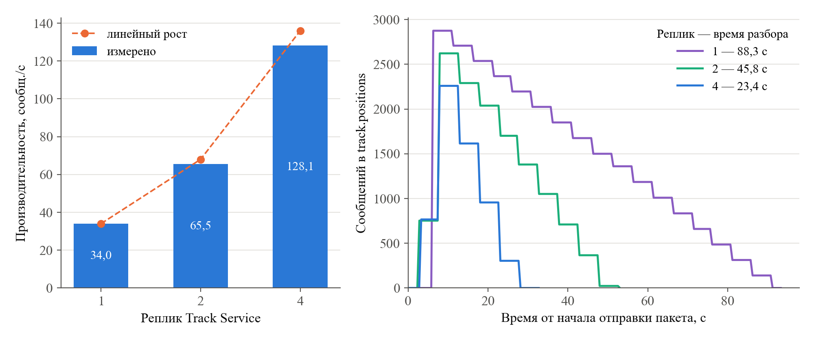
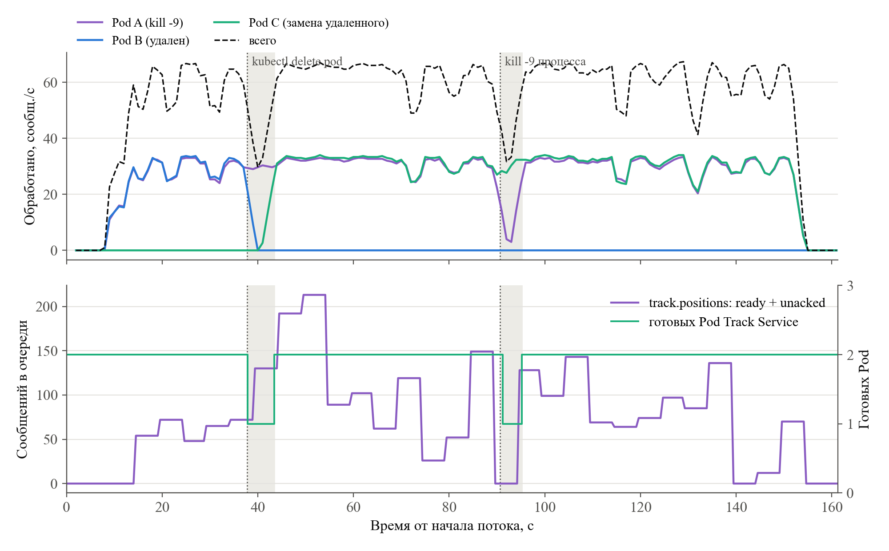

# Эксперименты ЛР 5: система в Kubernetes (kind)

## Эксперимент 1. Развертывание с одной репликой Track Service

`kubectl apply -k k8s/` в пустом кластере: все 7 Pod готовы за 24,2 с (включая выделение томов PVC). Первое развертывание на узлах без образов postgres:17 и rabbitmq:4.1-management – 62,5 с (скачивание образов ~40 с).

| Pod | Узел | Готов через, с | Перезапусков |
|---|---|---|---|
| analytics-service-798585c988-ft889 | transit-worker2 | 22,9 | 0 |
| dispatcher-api-84579f68bf-hbtkv | transit-worker | 11,9 | 0 |
| gateway-866c7ff975-29jhp | transit-worker | 20,9 | 0 |
| incident-service-7889867f97-h7tr7 | transit-worker2 | 20,9 | 0 |
| postgres-0 | transit-worker | 9,9 | 0 |
| rabbitmq-0 | transit-worker2 | 17,9 | 0 |
| track-service-d4b69b554-pbnhs | transit-worker | 20,9 | 0 |

| Сервис | Ожидалось | Обработано | Потеряно |
|---|---|---|---|
| track-service | 896 | 896 | 0 |
| analytics-service | 998 | 998 | 0 |
| incident-service | 4 | 4 | 0 |

Эмулятор (Job): 1000 событий {'vehicle.position': 896, 'ticket.validation': 102, 'vehicle.incident': 2}, разбор 27,1 с; DNS из Pod: {'rabbitmq': '10.96.88.133', 'postgres': '10.96.247.50', 'gateway': '10.96.83.254'}

## Эксперимент 2. Масштабирование под потоком 1 → 2 → 4

Поток: 300 машин, период 5 с, 65,8 событий/с, координат 57,1/с.

| Реплик | Интервал, с | Темп, сообщ./с | Очередь в начале → в конце | Тренд, сообщ./с |
|---|---|---|---|---|
| 1 | 0–60 | 33,3 | 0 → 1215 | 24,6 |
| 2 | 60–120 | 67,6 | 1354 → 955 | -8,2 |
| 4 | 120–180 | 70,2 | 659 → 0 | -13,3 |

Масштабирование: →2: Pod готовы за 5,4 с, потребители в очереди через 8,9 с; →4: Pod готовы за 6,2 с, потребители в очереди через 8,7 с
Очередь пуста через 24,3 с после перехода на 4 реплики. Потеряно: {'track-service': 0, 'analytics-service': 0, 'incident-service': 0}

## Эксперимент 4. Пакеты по 3000 координат

| Реплик | Сообщений | Разбор, с | Производительность, сообщ./с | Ускорение | Задержка ср./p95, с | Пик очереди | Распределение | Потеряно |
|---|---|---|---|---|---|---|---|---|
| 1 | 3000 | 88,3 | 34,0 | 1,00 | 42,9/80,6 | 2825 | 3000 | 0 |
| 2 | 3000 | 45,8 | 65,5 | 1,93 | 21,5/40,1 | 2522 | 1481/1519 | 0 |
| 4 | 3000 | 23,4 | 128,1 | 3,77 | 10,2/18,8 | 2059 | 741/756/742/761 | 0 |

## Эксперимент 3. Удаление Pod

Поток 65,2 событий/с, 2 реплики Track Service.

| Показатель | kubectl delete pod | kill -9 процесса |
|---|---|---|
| Экземпляр | track-service-6d767457d6-xvqbg | track-service-6d767457d6-b74q9 |
| Обнаружение отказа, с | замена создана через 0,41 | Pod не готов через 0,59, перезапуск через 1,79 |
| Новый экземпляр готов (readiness), с | 5,72 | 4,55 |
| Первая обработка новым экземпляром, с | 4,00 | 3,08 |

| Этап | Отказ | Темп, сообщ./с | Макс. очередь | Готовых Pod |
|---|---|---|---|---|
| до | delete | 59,2 | 72 | [2] |
| во время | delete | 40,5 | 130 | [1] |
| после | delete | 65,1 | 213 | [2] |
| до | kill | 61,0 | 149 | [2] |
| во время | kill | 40,8 | 128 | [1, 2] |
| после | kill | 65,1 | 143 | [2] |

Сверка: ожидалось {'track-service': 8541, 'analytics-service': 9823, 'incident-service': 31}, обработано {'analytics-service': 9823, 'track-service': 8541, 'incident-service': 31}, потеряно {'track-service': 0, 'analytics-service': 0, 'incident-service': 0}, повторных доставок {'track-service': 78}, попытки {'analytics-service:success': 9823, 'track-service:success': 8539, 'track-service:duplicate': 2, 'incident-service:success': 31}, DLQ {'analytics.positions.dlq': 0, 'analytics.validations.dlq': 0, 'incidents.dlq': 0, 'track.positions.dlq': 0}

Повторный kill -9 того же контейнера (прогон failover_backoff): перезапуск через 21,64 с, готов через 22,71 с (CrashLoopBackOff).
